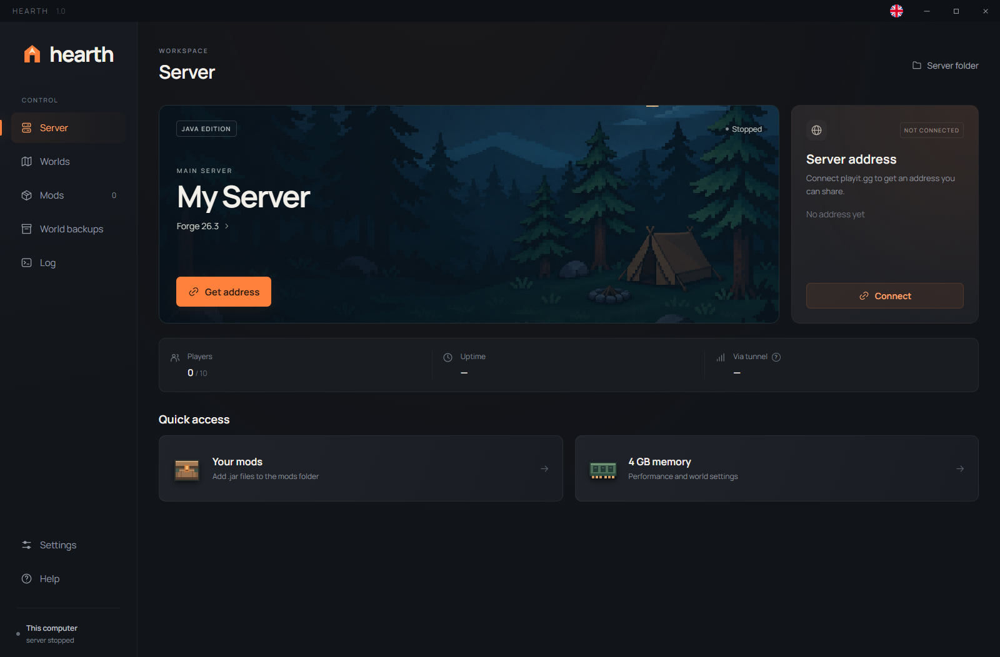
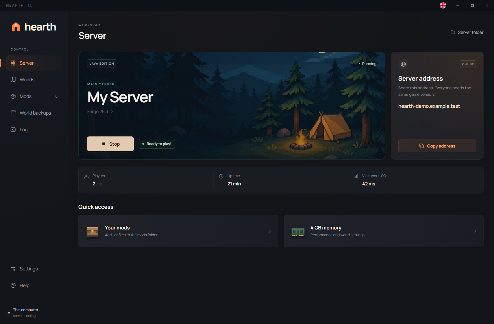
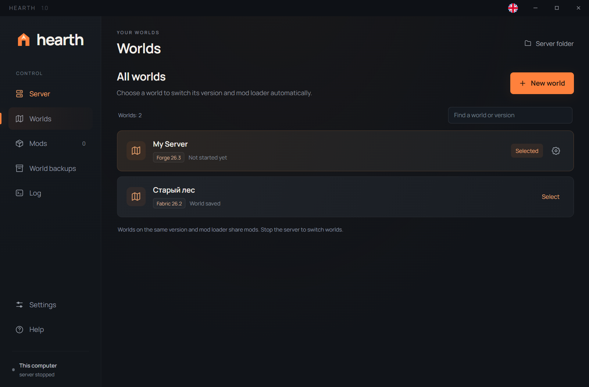
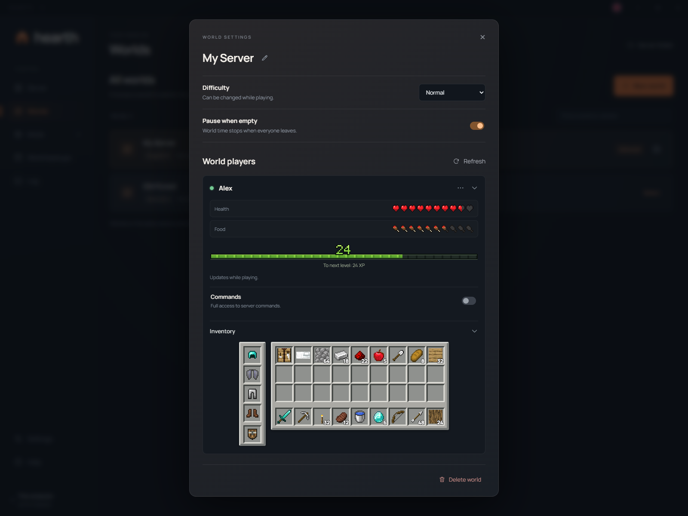

# Hearth

Host a Minecraft Java server from your Windows PC. Choose a world, start the server, and share an address through playit.gg.

Screenshots use sample worlds, player data, and address.

Player details:

Hearth supports Fabric, Forge, and NeoForge. It keeps worlds, mods, backups, and server settings together, and shows player status from saved world data.

## Download

Get the Windows installer from [Releases](https://github.com/end1cott/hearth/releases). A portable ZIP is available there too. Hearth runs on Windows 10/11 x64.

This early release is unsigned. Windows may show a SmartScreen warning. Download only from this repository and check the SHA-256 values in the release files.

## Getting started

1. Install Hearth, or extract the entire portable ZIP and run `Hearth.exe`.
2. Create a world and choose its Minecraft version and loader.
3. Connect a playit.gg account and get your server address. You only need to set this up once; Hearth remembers the connection for future launches.
4. Start the server and accept the Minecraft EULA when prompted. Hearth downloads the server and Java it needs. Share the address shown in Hearth with your players.

Players need a compatible Minecraft Java version and any required client-side mods. Your computer must stay on while hosting.

## Data and help

Worlds, mods, backups, and settings live in the `data` folder beside `Hearth.exe`. Keep this folder when moving or reinstalling Hearth. **Do not share it:** it may contain your playit.gg account key.

Found a problem? [Open an issue](https://github.com/end1cott/hearth/issues/new/choose). Please do not attach your `data` folder or unredacted logs.

Hearth is an independent project and is not affiliated with Mojang or Microsoft.
